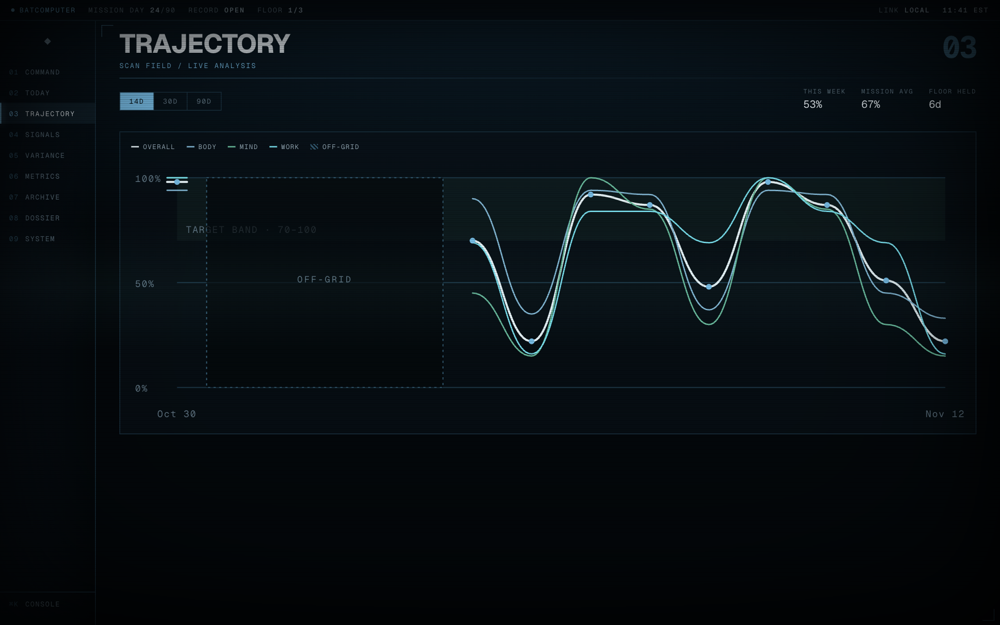
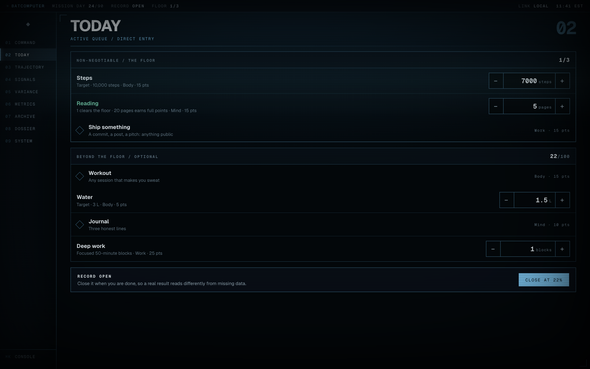

# BATCOMPUTER

A private mission terminal for a goal challenge you define. Not a habit tracker.

You pick the goals, how each one is counted, and how long the mission runs.
The terminal scores every day out of 100, shows where you are drifting, and
forgives the days life got in the way.





*Screenshots use sample data.*

## What makes it different

- **A floor and a score.** A few signals decide whether the day counts at all.
  The 0–100 score says how good it was. Clearing the floor on a bad day still
  keeps your run alive.
- **Gaps are survivable.** Missed days are sealed as OFF-GRID, not failures.
  A break ends your current run but never erases your longest one.
- **Yours in one file.** Every goal, target and weight lives in
  [`mission.config.ts`](mission.config.ts).
- **Works with nothing set up.** No account, no database, no keys. Your record
  stays in your browser until you choose to add cloud sync.
- **Alfred.** One dry remark a day, written from your real numbers. Optional.

## Quick start

You need Node.js 22.13 or newer.

```bash
git clone https://github.com/mihhhir08/momentum-90.git batcomputer
cd batcomputer
npm install
npm run dev
```

Open http://localhost:3000. Press any key to leave the boot screen.

You will see simulation data first. Press **START TODAY** to begin your own
mission. From then on, your record is saved in this browser.

## Make it yours

Open [`mission.config.ts`](mission.config.ts). It is the only file you need to
edit.

### 1. Set the basics

```ts
days: 90,                       // length of the challenge
timezone: "America/New_York",   // decides when "today" rolls over
locale: "en-US",                // number and date formatting
honorific: "sir",               // how Alfred addresses you
```

### 2. Name your goals

Goals are the big areas. Each one gets its own score and its own line on the
chart.

```ts
goals: [
  { id: "Body", color: "#82b6d3" },
  { id: "Mind", color: "#68b99b" },
  { id: "Work", color: "#78ddeb" },
],
```

### 3. Add your signals

A signal is one thing you track each day. Choose how it is counted:

| Type | Use it for | How it scores |
|---|---|---|
| `check` | Done or not done: workout, journal, no sugar | Ticked earns all its points |
| `count` | A number toward a daily target: steps, pages, litres | Half the target earns half the points |
| `measure` | A number you only watch: weight, sleep hours | Never scored, charted in METRICS |

```ts
signals: [
  // Done or not done.
  { key: "workout", label: "Workout", goal: "Body", type: "check", points: 15 },

  // A number toward a target. 5,000 steps earns half of the 15 points.
  { key: "steps", label: "Steps", goal: "Body", type: "count",
    target: 10000, step: 500, unit: "steps", points: 15 },

  // Watched only.
  { key: "weight", label: "Weight", type: "measure", unit: "kg", step: 0.1 },
],
```

Every field:

| Field | Needed for | Meaning |
|---|---|---|
| `key` | all | Short unique name, letters and digits only. Your data is stored under it, so do not rename it mid-mission. |
| `label` | all | What the terminal shows |
| `type` | all | `check`, `count` or `measure` |
| `goal` | check, count | Which goal the points roll up into |
| `points` | check, count | How much this signal is worth |
| `target` | count | The daily number that earns full points |
| `step` | count, measure | How far one press of + or − moves the number |
| `unit` | count, measure | Shown next to the number |
| `note` | optional | A short line under the label |
| `tiers` | optional, count | Fixed points at fixed thresholds (see below) |
| `floor` | optional | Makes the signal part of the floor (see below) |
| `band` | optional, measure | A goal range drawn on the trend, such as `[70, 72]` |

**Points are relative.** They do not need to add up to 100. The day's score is
points earned divided by points available. A signal worth 20 simply matters
twice as much as one worth 10.

**Tiers** replace half-credit with steps. This pays 1 point at 1 litre, 3 at 2
and all 5 at 3:

```ts
{ key: "water", label: "Water", goal: "Body", type: "count",
  target: 3, step: 0.25, unit: "L", points: 5,
  tiers: [[1, 1], [2, 3], [3, 5]] },
```

For all-or-nothing, use one tier at the target: `tiers: [[10, 20]]`.

### 4. Choose your floor

The floor is the short list of signals that decide whether a day counts.
Keep it small and easy enough to clear on your worst day.

```ts
floor: true   // the signal must be complete
floor: 1      // a count only has to reach 1, well below its full target
```

### 5. Check your work

```bash
npm test
```

The tests read your config and tell you in plain words if something is wrong,
such as a duplicate key or a signal pointing at a goal that does not exist.

## The nine sectors

| Key | Sector | What it shows |
|---|---|---|
| `1` | COMMAND | Floor status, today's score, level, Alfred |
| `2` | TODAY | Where you log the day |
| `3` | TRAJECTORY | Score trends over 14, 30 or 90 days |
| `4` | SIGNALS | One signal at a time: runs, rate, history |
| `5` | VARIANCE | This week against last week, per goal |
| `6` | METRICS | Your measures and their trends |
| `7` | ARCHIVE | Every day of the mission as a map |
| `8` | DOSSIER | Averages, weeks, mission gates |
| `9` | SYSTEM | Sync state, backups, share links, audio |

| Key | Action |
|---|---|
| `1`–`9` | Jump to a sector |
| `↑` `↓` | Previous or next sector |
| `⌘K` / `Ctrl K` | Command console |
| Any key | Leave the boot screen |

In the console you can type `log steps 8000` to set any number, or `close` to
close the day.

## Optional extras

Everything below is optional. Skip all of it and the terminal still works.
Each extra uses **your own account and your own keys**. Nothing in this repo
connects to anyone else's services.

Copy the example file first:

```bash
cp .env.example .env.local
```

### Lock it with a PIN

```bash
MISSION_PIN=4821
```

The terminal asks for the PIN on boot. Five wrong attempts lock the pad for
15 minutes.

### Sync across devices (Supabase)

Without this, your record lives in one browser. With it, the record is
mirrored to a database you own.

1. Create a free project at [supabase.com](https://supabase.com).
2. Open **SQL Editor**, paste the contents of
   [`supabase/schema.sql`](supabase/schema.sql), and run it.
3. Open **Project Settings → API** and copy the project URL and the
   `service_role` key.
4. Add them to `.env.local`:

   ```bash
   SUPABASE_URL=https://your-project.supabase.co
   SUPABASE_SERVICE_ROLE_KEY=your-service-role-key
   MISSION_PIN=4821
   ```

The `service_role` key has full access to your database. Keep it in
`.env.local` or your host's environment settings, and never commit it.

**A deployed terminal will not sync without `MISSION_PIN`.** Without a PIN,
anyone who found your URL could read and change your record, so the cloud
stays off until one is set.

### Alfred's daily remark (OpenRouter)

```bash
OPENROUTER_API_KEY=sk-or-...
OPENROUTER_MODEL=anthropic/claude-haiku-4.5
```

Get a key at [openrouter.ai](https://openrouter.ai). Alfred is sent only the
day number, your scores and your run lengths. Without a key he stays silent.

### Nightly nudge email (Resend)

An email at night, only if the floor is still open. Needs cloud sync.

```bash
RESEND_API_KEY=re_...
NUDGE_EMAIL=you@example.com
CRON_SECRET=a-long-random-string
```

Get a key at [resend.com](https://resend.com). The schedule is in
[`vercel.json`](vercel.json) and uses UTC: `0 1 * * *` is 01:00 UTC. Change it
to suit your evening.

### Share a read-only link

In SYSTEM, **GENERATE READ-ONLY LINK** creates a snapshot page for a friend.
It contains scores only. Measures and per-signal detail are never included.
**REVOKE ALL LINKS** deletes every snapshot. Needs cloud sync.

## All environment variables

| Variable | What it does | If it is missing |
|---|---|---|
| `MISSION_PIN` | Four-digit PIN on boot | Terminal opens freely; cloud sync stays off in production |
| `SUPABASE_URL` | Your Supabase project URL | Local storage only |
| `SUPABASE_SERVICE_ROLE_KEY` | Server-side database key | Local storage only |
| `OPENROUTER_API_KEY` | Alfred's remark | Alfred stays silent |
| `OPENROUTER_MODEL` | Which model Alfred uses | `anthropic/claude-haiku-4.5` |
| `RESEND_API_KEY` | Sends the nightly nudge | No nudge |
| `NUDGE_EMAIL` | Where the nudge goes | No nudge |
| `NUDGE_FROM` | Sender name and address | Resend's test sender |
| `CRON_SECRET` | Protects the nudge route | The route refuses every caller |

## Deploy

[](https://vercel.com/new/clone?repository-url=https://github.com/mihhhir08/momentum-90)

1. Fork this repo and edit `mission.config.ts`.
2. Import your fork at [vercel.com/new](https://vercel.com/new).
3. Add the environment variables you want under **Settings → Environment
   Variables**.
4. Deploy. On a phone or desktop, "Install app" gives it its own window.

Any host that runs Next.js works. The nightly nudge relies on Vercel Cron; on
another host, call `GET /api/nudge` with the header
`Authorization: Bearer <CRON_SECRET>` from your own scheduler.

## Security

- **No keys in the browser.** Only the server reads the database key. The
  browser talks to `/api/mission` and nothing else.
- **No sign-in to attack.** One operator, one optional PIN. The PIN is checked
  on the server and the cookie it sets is a signature, not the PIN.
- **Locked routes.** With a PIN set, the mission, share and Alfred routes all
  refuse callers without clearance.
- **Validated writes.** The API stores only the signals in your config, as
  booleans and bounded numbers. Everything else is dropped.
- **Closed database.** Row level security is on with no policies, so the
  public Supabase key can read nothing.
- **Not indexed.** Every route sends `noindex` and refuses to be framed.

A four-digit PIN is a lock for a personal tool, not a vault. For stronger
protection, turn on your host's own access control, such as Vercel Deployment
Protection.

Found a security problem? Please open a private
[security advisory](https://github.com/mihhhir08/momentum-90/security/advisories/new)
rather than a public issue.

## Backups

SYSTEM → **DOWNLOAD BACKUP** saves your whole record as a JSON file.
**RESTORE FROM FILE** merges one back in by date. Do this before you clear
your browser data or change signal keys.

## Project layout

```
mission.config.ts       your goals, signals, floor and mission length
app/
  page.tsx              composes the terminal, calculates nothing
  api/mission/          the only route that reads or writes your record
  api/unlock/           PIN check
  api/alfred/           daily remark via OpenRouter
  api/nudge/            nightly email, called by cron
  api/share/            create and revoke read-only snapshots
  dossier/[token]/      the public read-only page
components/
  shell/                boot, rail, viewport, console, PIN pad
  sectors/              the nine sectors
lib/mission/            all logic, no React except useMission
lib/clearance.ts        PIN cookie signing
lib/cloud.ts            the one place a database key is read
supabase/schema.sql     tables for your own Supabase project
tests/                  node-runnable assertions, no framework
```

## Development

```bash
npm run dev        # local server
npm test           # logic tests, CSS audit, production build
npm run lint
```

The tests run under plain `node`, with no test framework and no browser.

## Contributing

Issues and pull requests are welcome. Run `npm test` before opening one.

## License

[MIT](LICENSE). Built by [Mihirsinh Chavda](https://mihirsinhchavda.com).

BATCOMPUTER is an unofficial fan project. It is not affiliated with or
endorsed by DC or Warner Bros. Batman and related names belong to their
owners.
